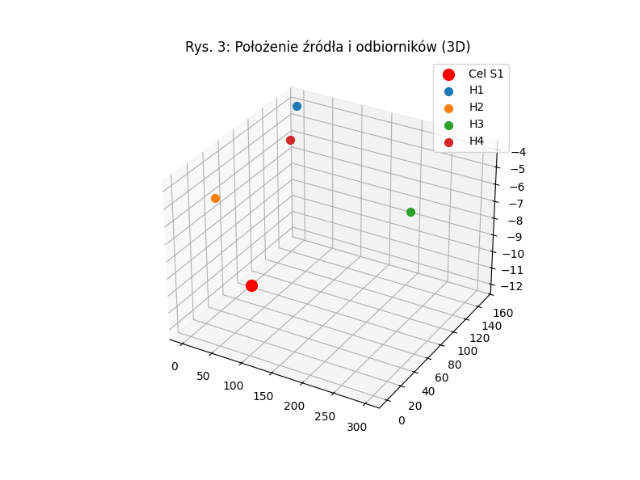
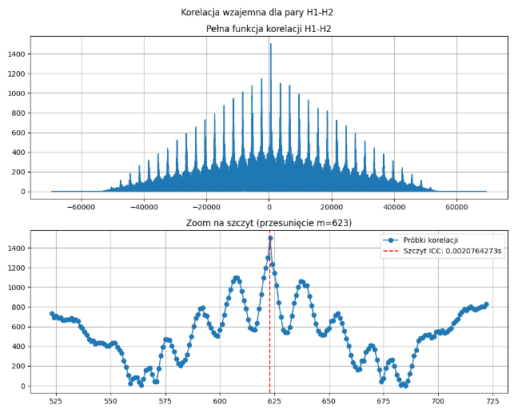
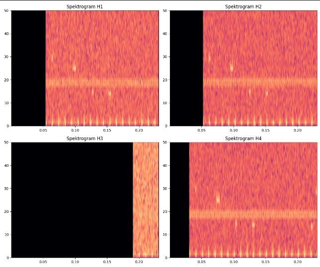
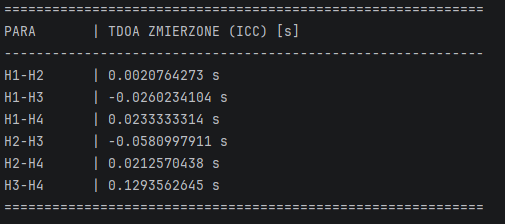

# Breakthrough in Sampling Limits: Accurate Underwater Sound Time Difference of Arrival Estimation Method Based on Cumulative Cross-Correlation and Subsample Parabolic Interpolation [with Python code]

Breakthrough in Sampling Limits: High-Precision Acoustic Time Difference of Arrival (TDOA) Estimation Method Based on Cumulative Cross-Correlation and Subsampled Parabolic Interpolation in Modern Anti-Submarine Warfare (ASW) Tasks
In modern anti-submarine warfare (ASW) missions, distributed passive acoustic monitoring clusters composed of unmanned surface vehicles (USVs) and unmanned aerial vehicles (UAVs) are receiving increasing attention. These systems can achieve positioning solely by receiving the radiation noise from targets without the need for transmitting detection pulses, offering strong concealment and endurance capabilities. One of the core technologies that enable this capability is high-precision arrival time difference (TDOA) estimation—determining the distance and direction of a target from a very small time difference.
However, there is an inherent contradiction in passive acoustic positioning: the resolution limit introduced by discrete sampling. At a typical sampling rate of 300 kHz, the interval between adjacent sampling points is about 3.33 microseconds, corresponding to an underwater sound range of about 5 millimeters, which far fails to meet the requirements for centimeter-level or even higher precision positioning. Traditional approaches involve either increasing the sampling rate or adopting expensive high-precision clock synchronization equipment, which significantly increases power consumption, cost, and system complexity, making it unfavorable for cluster applications with a large number of inexpensive nodes.
This paper introduces a method that, without altering hardware conditions, utilizes cumulative cross-correlation and parabolic interpolation (ICC) in combination to break through the resolution barrier of discrete sampling, pushing the accuracy of TDOA estimation to the nanosecond level. The method performs subsampled delay estimation using a quadratic curve fitting around the peak of the cross-correlation function at minimal computational cost, combining both engineering practicality and theoretical elegance.
1. Signal Design: A comb-like multi-tone signal with high correlation gain is used to obtain robust time delay estimates in strong environmental noise. The system employs a multi-tone signal (Multi-tone signal) as the source waveform. This signal consists of 11 sinusoidal waves with equal frequency intervals, with the fundamental frequency set at 1 kHz and the highest harmonic reaching up to 20 kHz. Each single-frequency component has the same amplitude.
This "comb-like spectrum" design presents multiple discrete spectral lines in the frequency domain, with a sharp main peak and low sidelobes in its autocorrelation function. This can significantly enhance processing gain and effectively suppress environmental white noise. The signal generator also incorporates minor Gaussian white noise and random pulse tone noise to simulate broadband and narrowband interference in real marine environments, thereby testing the algorithm's robustness.
II. Multipath propagation and signal modeling simulation environment for underwater acoustics: A quadrilateral asynchronous hydrophone array was set up, with the target sound source located 12 meters underwater and the hydrophones deployed at different depths of 4 meters below the surface. The propagation model considered three paths.
1  
Direct path: Sound travels directly from the source to the hydrophone, with a path length of;
2  
Sea surface reflection path: Reflected once on the sea surface.
3  
Underwater reflection path: reaches through one underwater reflection.
The propagation loss along each path is described by the logarithmic distance law, with an acoustic absorption coefficient of 0.5 dB/10 m and a fixed sound speed of 1500 m/s. The reflection coefficients at the sea surface and bottom are set to 0.1 (corresponding to an absorption coefficient of 0.9), which means that each reflection results in approximately a 20 dB loss, ensuring that direct waves remain the dominant energy component.
The received signal is the delay of three paths signals and the local noise related to propagation distance.
The amplitude attenuation coefficients for each path, the corresponding propagation delay, and additive Gaussian white noise to ensure a certain signal-to-noise ratio are all included. By generating multi-channel signals under different scenarios (symmetric and asymmetric array configurations), this provides near-realistic test data for subsequent TDOA algorithms.
III. Accumulative Cross-Correlation and Initial Estimation of Integer Lag
For the two hydrophones receiving signals, the cumulative cross-correlation function is defined as:
Where denotes the number of integer lag samples, and denotes the analysis window length. The peak position corresponds to an integer lag that provides a rough time delay estimate in units of the sampling period:
At a 300 kHz sampling rate, this results in a temporal resolution of approximately 3.33 μs, corresponding to a distance error of about 5 mm, which still does not meet the high accuracy requirements below centimeter levels. To further break through this limit, subsample interpolation is needed.
IV. Subsample Parabolic Interpolation: Core Principle of ICC
In the vicinity of the peak of the correlation function, its shape approximates a quadratic curve. If discrete samples at the maximum correlation value and their adjacent samples on both sides are taken, a parabola passing through these three points can be fitted:
Given the coordinates of these three points, substitute into the solution to find the horizontal offset of the parabola's vertex:
This offset is the displacement of the true correlation peak relative to the discrete maximum value in terms of subsampled data. The final refined TDOA estimation is:
This interpolation algorithm is entirely based on arithmetic operations, avoiding the massive computational burden of frequency domain interpolation or upsampling, yet it effectively enhances the temporal resolution to one-thousandth or even thousandth of the sampling interval, reaching nanosecond level precision. At a 300 kHz sampling rate, if precise to 0.01, the temporal resolution can reach about 0.03 microseconds, corresponding to a distance resolution of about 0.05 millimeters, far exceeding the required centimeter level for positioning.
5. Experimental Verification and Performance Analysis
To validate the method, two geometric configurations were established: \\ Symmetric Scenario (S1)\\ For system calibration, the target is positioned on the horizontal plane with equal distance from both hydrophones, theoretical TDOA should be zero; \\ Asymmetric Scenario (S2)\\ Simulates the situation of target offset in actual combat, there is a significant delay. The symmetric placement of hydrophones H1 and H2 ensures that the cross-correlation peak accurately falls at an integer position without lag, and the parabolic interpolation provides very small subsample offsets, with measured TDOA approximately -2.147×10⁻⁷ s, an absolute error of only about 215 ns, which conforms to the slight fluctuation caused by noise.
In the asymmetric scenario, the TDOA measurement value for H1-H2 pair is -0.0020764273 s, only deviating by 185 ns from the theoretical value; the independent verification of H3-H4 pair gives TDOA as 0.1293562645 s, with an error of 162 ns. The nanosecond level error in these three sets of measurements fully demonstrates the subsampling point estimation capability of parabolic interpolation under any delay.
Moreover, spectral analysis shows that despite multipath interference and broadband noise, all harmonics of the multi-tone signal can still be clearly discerned, ensuring the sharpness of the cross-correlation peaks, which is an important prerequisite for high precision ICC interpolation.
6. Implications for Researchers and Engineering Value
The methods described in this paper have several points worth consideration for researchers in related fields:
1. Calculation Efficiency: Parabolic interpolation requires only three correlation values read and one arithmetic operation, significantly reducing computational load compared to sinc interpolation or up-sampling cross-correlation, making it highly suitable for deployment on embedded platforms with limited computing power (such as ARM processors).
2. No Need for Additional Synchronization Hardware: The improved accuracy is entirely driven by the algorithm, independent of external high-stability clocks, which is beneficial for distributed time difference positioning by a large number of inexpensive nodes forming an unmanned cluster.
3.
Robustness Verification: The algorithm maintains sub-microsecond error levels even with the addition of multipath, random pulse noise, and under different geometric configurations, indicating its good adaptability to real hydroacoustic channels.
4  
Direct Extension: Four hydrophones can provide six sets of independent TDOA measurements, combined with subsequent Multilateration (MLAT) algorithms, which can calculate the three-dimensional coordinates of the target. The introduction of smoothing filters such as Kalman filtering can further achieve tracking of moving targets.
VII. Future Development and Outlook: Building on the existing foundation, the next steps will focus on:
Integrating TDOA measurement results with Gaussian-Newton Iterative Positioning Algorithm to form a complete passive positioning computing pipeline;
Introducing adaptive multipath suppression technology to further improve delay estimation accuracy in extreme multipath environments;
Completing algorithm porting and real-time verification on real cluster hardware platforms, promoting the method from simulation to actual ocean trials.
Conclusion:
Breaking through the physical limitations of discrete sampling is an eternal pursuit in the field of weak signal detection and precision measurement. The cumulative cross-correlation and subsample parabola interpolation methods introduced in this paper achieve nanosecond-level time difference estimation in underwater passive acoustic positioning with minimal mathematical models and high computational efficiency, providing solid technical support for a new generation of autonomous and distributed anti-submarine networks. We hope this idea can bring new inspiration to colleagues exploring high-precision TDOA estimation.

## Images

<!-- PAYMENT_BLOCK -->

## Get this dataset

- Payment link (Stripe): [Buy now](https://buy.stripe.com/3cs8yP7sY87d0vu9AB)
- Payment QR code: 

<!-- /PAYMENT_BLOCK -->
